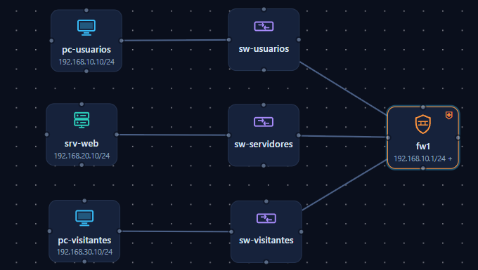
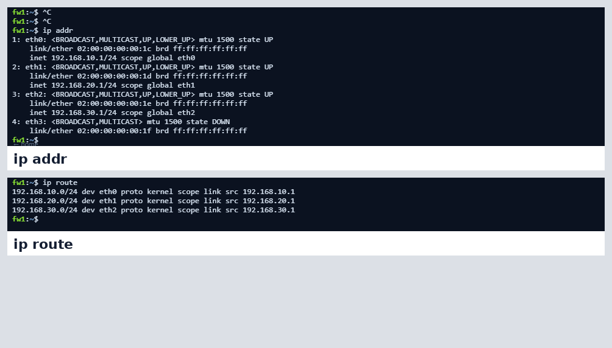
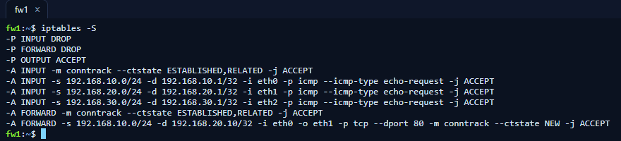
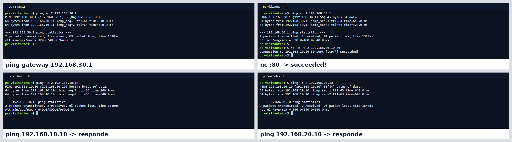
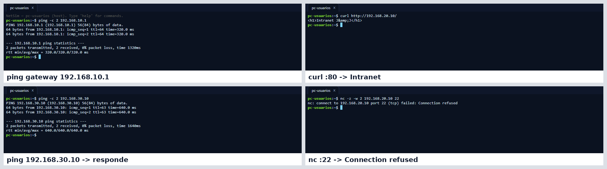
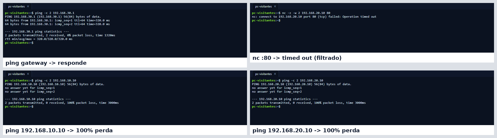
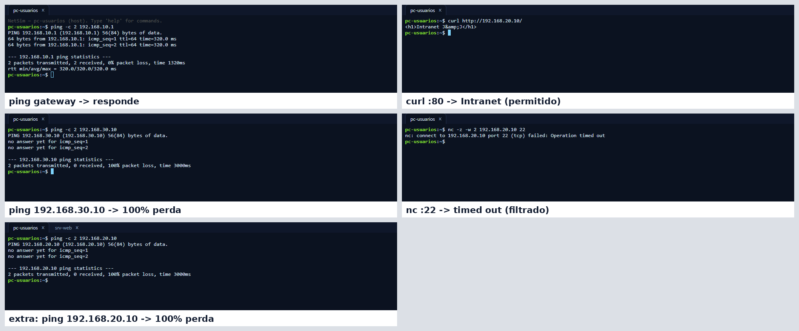
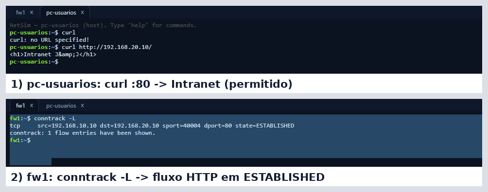

# Network Hardening Lab: segmentação em 3 zonas com firewall stateful

Laboratório prático de Blue Team: uma rede com três zonas (Usuários, Servidores e Visitantes) que, apesar de separadas fisicamente, se comunicavam livremente. Apliquei uma política de **menor privilégio** com `iptables` e comprovei cada bloqueio com **testes antes/depois** e **análise do log do firewall**.

> **Resultado:** dos 8 testes entre zonas que passavam antes, só 1 continua passando: HTTP de Usuários para o servidor web. Todos os bloqueios foram confirmados por uma linha `policy drop` no log do firewall.

**Ambiente:** [NetSim](https://netsim.borck.education), simulador de redes no navegador com sintaxe Linux real.
**Contexto:** atividade prática de um bootcamp de Cibersegurança (out/2026), entrega individual.

---

## 1. O problema

Segmentar a rede em switches diferentes **não isola nada** se o firewall entre eles encaminha todo o tráfego. Antes do hardening:

- um **visitante** alcançava o servidor web e as estações de trabalho;
- o **servidor** podia iniciar conexões para as estações (se comprometido, serviria de ponto de partida para movimento lateral);
- a política do firewall era `ACCEPT` em todas as cadeias.

## 2. Topologia



| Zona | Rede | Host | Gateway (fw1) |
|---|---|---|---|
| Usuários | 192.168.10.0/24 | pc-usuarios: 192.168.10.10 | 192.168.10.1 (eth0) |
| Servidores | 192.168.20.0/24 | srv-web: 192.168.20.10 (HTTP/80) | 192.168.20.1 (eth1) |
| Visitantes | 192.168.30.0/24 | pc-visitantes: 192.168.30.10 | 192.168.30.1 (eth2) |

A interface não utilizada do firewall (`eth3`) foi desativada. No servidor, só o serviço web ficou ativo (DHCP, DNS e portas extras desligados).



## 3. Política de menor privilégio

| Origem | Destino | Tráfego | Ação | Por quê |
|---|---|---|---|---|
| Usuários | srv-web | TCP/80, novas conexões | Permitir | Único fluxo de negócio necessário |
| Qualquer | Qualquer | Respostas de conexões já permitidas | Permitir | Sem o retorno, o HTTP não funciona |
| Cada zona | Próprio gateway | ICMP echo-request | Permitir | Diagnóstico local |
| Todo o resto | — | — | Bloquear | Bloqueio padrão (default deny) |

## 4. Regras aplicadas

```bash
# Bloqueio padrão: o que não for explicitamente permitido é negado
iptables -P INPUT DROP        # tráfego destinado ao próprio firewall
iptables -P FORWARD DROP      # tráfego que atravessa o firewall entre as zonas
iptables -P OUTPUT ACCEPT     # o firewall pode responder

# INPUT: protege o próprio firewall
iptables -A INPUT -m conntrack --ctstate ESTABLISHED,RELATED -j ACCEPT
iptables -A INPUT -i eth0 -s 192.168.10.0/24 -d 192.168.10.1 -p icmp --icmp-type 8 -j ACCEPT
iptables -A INPUT -i eth1 -s 192.168.20.0/24 -d 192.168.20.1 -p icmp --icmp-type 8 -j ACCEPT
iptables -A INPUT -i eth2 -s 192.168.30.0/24 -d 192.168.30.1 -p icmp --icmp-type 8 -j ACCEPT

# FORWARD: só o fluxo de negócio e o retorno das conexões
iptables -A FORWARD -m conntrack --ctstate ESTABLISHED,RELATED -j ACCEPT
iptables -A FORWARD -i eth0 -o eth1 -s 192.168.10.0/24 -d 192.168.20.10 \
         -p tcp --dport 80 -m conntrack --ctstate NEW -j ACCEPT
```

A regra do HTTP fixa **interface de entrada e saída, origem, destino, protocolo, porta e estado**. Uma regra ampla como "Usuários → Servidores, qualquer porta" também faria o HTTP funcionar, mas exporia qualquer serviço habilitado no servidor no futuro.



## 5. Validação: antes × depois

| Origem → destino | Teste | Antes | Depois |
|---|---|---|---|
| Cada zona → próprio gateway | `ping` | Responde | Responde |
| Usuários → srv-web | `curl :80` | Página Intranet | **Página Intranet (permitido)** |
| Visitantes → srv-web | `nc -z :80` | succeeded | **timed out** |
| Visitantes → Usuários | `ping` | Responde | **100% de perda** |
| Visitantes → srv-web | `ping` | Responde | **100% de perda** |
| srv-web → Usuários | `ping` | Responde | **100% de perda** |
| Usuários → Visitantes | `ping` | Responde | **100% de perda** |
| Usuários → srv-web | `nc -z :22` | Connection refused | **timed out** |
| Usuários → srv-web | `ping` | Responde | **100% de perda** |

Antes de testar o "depois", conferi que a tabela de conntrack estava vazia (`0 flow entries`). Assim nenhum teste foi aceito indevidamente por uma conexão antiga ainda em estado ESTABLISHED.

<details>
<summary>Prints dos testes</summary>

**Visitantes, antes:**


**Usuários, antes:**


**Visitantes, depois:**


**Usuários, depois:**


</details>

## 6. Evidência no log do firewall

Um teste que falha não prova nada sozinho, porque o timeout pode ser erro de rota, cabo ou serviço. Por isso, cada resultado foi relacionado a uma linha do log.

**Fluxo permitido: handshake HTTP completo** (lido de baixo para cima)

```
1929.8s FORWARD ACCEPT tcp 192.168.20.10:80 > 192.168.10.10:40004 [ACK]      ← ct state established,related accept
1929.5s FORWARD ACCEPT tcp 192.168.10.10:40004 > 192.168.20.10:80 [ACK]      ← ct state established,related accept
1929.2s FORWARD ACCEPT tcp 192.168.20.10:80 > 192.168.10.10:40004 [SYN,ACK]  ← ct state established,related accept
1928.9s FORWARD ACCEPT tcp 192.168.10.10:40004 > 192.168.20.10:80 [SYN]
        ← iifname "eth0" oifname "eth1" ip saddr 192.168.10.0/24 ip daddr 192.168.20.10 tcp dport 80 ct state new accept
```

Só o **SYN** passou pela regra da porta 80. O resto da conexão passou pela regra de **estado** (`established,related`). É o firewall stateful na prática.



**Fluxos bloqueados:**

```
1996.8s FORWARD DROP icmp echo-request 192.168.30.10 > 192.168.10.10   ← policy drop
1979.4s FORWARD DROP tcp 192.168.30.10:40002 > 192.168.20.10:80 [SYN]  ← policy drop
1646.9s FORWARD DROP icmp echo-request 192.168.10.10 > 192.168.20.10   ← policy drop
1629.3s FORWARD DROP icmp echo-request 192.168.20.10 > 192.168.10.10   ← policy drop
1601.1s FORWARD DROP tcp 192.168.10.10:40003 > 192.168.20.10:22 [SYN]  ← policy drop
```

O SYN do visitante para a porta 80 **não** passou pela regra do HTTP, porque ela exige origem `192.168.10.0/24` e entrada pela `eth0`. O pacote veio de `192.168.30.10` pela `eth2`. Para uma regra se aplicar, todos os campos precisam bater.

## 7. O que aprendi

- **`Connection refused` × `timed out`:** *refused* significa que o host respondeu "não há serviço nesta porta" (porta fechada). *Timed out* significa que ninguém respondeu, porque o pacote foi descartado no caminho (filtrado). É a mesma lógica que o Nmap usa para classificar portas como *closed* e *filtered*.
- **TTL como evidência de roteamento:** o ping ao gateway voltou com `ttl=64` e o ping a outra zona com `ttl=63`. O decremento prova que o pacote atravessou o firewall.
- **DROP × REJECT:** com `REJECT`, o firewall avisaria a origem e o teste daria *refused*. Com `DROP`, ele silencia, o que dá menos informação a quem está fazendo reconhecimento.
- **Evidência é a saída, não o comando digitado:** o `iptables -S` normaliza as regras (`--icmp-type 8` vira `echo-request`, `/32` aparece no destino). O registro que vale é o que o sistema mostra.

## 8. Relação com MITRE ATT&CK

| Controle aplicado | Mitigação | O que dificulta |
|---|---|---|
| Zonas separadas com bloqueio padrão | M1030 – Network Segmentation | Movimento lateral entre zonas |
| Só TCP/80 liberado; SSH e ICMP bloqueados | M1037 – Filter Network Traffic | T1021.004 – Remote Services: SSH; T1046 – Network Service Discovery |

## 9. Limitações

- Tráfego **dentro** do mesmo segmento não passa pelo firewall e não é controlado por estas regras.
- O serviço usa **HTTP** sem criptografia. Em produção, o adequado seria HTTPS.
- O firewall decide por IP, porta e estado. Um ataque dentro do tráfego permitido (por exemplo, exploração via HTTP) não seria detectado. Um IDS/IPS e o envio dos logs para um SIEM complementariam o controle.
- O NetSim não implementa contadores de regras (`iptables -v`) nem o alvo `LOG`. Os descartes foram comprovados pelo painel de log do simulador, e o fluxo permitido, pelo `conntrack -L`.

## 10. Como reproduzir

1. Abra o [NetSim](https://netsim.borck.education) e clique em **New**.
2. Monte a topologia da seção 2. **A ordem dos cabos no fw1 define eth0, eth1 e eth2.**
3. Configure os IPs e as rotas padrão dos hosts e ative `net.ipv4.ip_forward=1` no fw1.
4. Rode os testes da seção 5 (antes), aplique as regras da seção 4 **uma única vez** e repita os testes.
5. Compare os resultados com o painel **Firewall log** do fw1.

---

**Marcos Barbosa** · Em transição para SOC / Blue Team · AWS Certified Solutions Architect – Associate
[LinkedIn](https://www.linkedin.com/in/marcos-barbosa-carvalho-dos-santos-60bb4023b)
